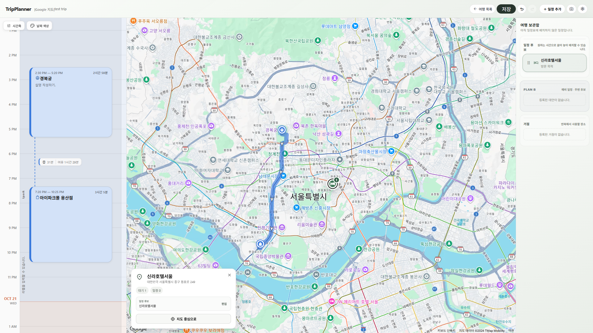

# TripPlanner




**지도 위의 장소와 시간표 위의 일정을 하나의 여행 계획으로 연결하는 셀프 호스팅 웹 애플리케이션**

TripPlanner는 방문 후보를 먼저 모으고, 이를 날짜별 타임라인에 배치하며, 이동 경로·거점·대안 일정(PLAN B)을 함께 관리하는 여행 계획 서비스입니다. React 기반 편집 화면, Node.js/SQLite 서버, 사용자·여행별 접근 권한 및 Google Maps / NAVER Maps 연동을 제공합니다.

> **배포 안내**  
> Linux 운영 환경에서는 저장소 루트의 **[`install.sh`](./install.sh)**로 Rootless Podman 이미지 빌드와 Quadlet 등록을 자동화할 수 있습니다. 지도 API 키 및 관리자 계정은 설치 후 설정하며, 캐시 보존 정책은 웹 관리자 페이지에서 운영자가 관리합니다.

## 목차

- [주요 기능](#주요-기능)
- [기술 구성](#기술-구성)
- [빠른 설치: Rootless Podman + Quadlet](#빠른-설치-rootless-podman--quadlet)
- [서비스 운영 및 업데이트](#서비스-운영-및-업데이트)
- [캐시 정책과 외부 지도 API](#캐시-정책과-외부-지도-api)
- [로컬 개발 및 테스트](#로컬-개발-및-테스트)
- [프로젝트 구조](#프로젝트-구조)
- [데이터와 보안](#데이터와-보안)
- [문제 해결](#문제-해결)
- [Credits & License](#credits--license)

---

## 주요 기능

### 타임라인과 장소 보관함

- 날짜 및 시간에 맞춰 일정 배치, 드래그 앤 드롭으로 이동·시간 조정
- 시작·종료 시간, 체류 시간, 일정 겹침 및 배치 상태 확인
- 날짜별/일정별 색상, Undo / Redo
- 아직 배치하지 않은 장소와 일정을 **보관함**에 모아 두고 타임라인과 왕복 이동
- 장소 데이터와 방문 일정을 구분하여 동일한 장소를 여러 번 활용

### PLAN B · 거점 · 주요 이동

- **PLAN B:** 기존 일정 주변의 대안 후보를 보관하며, 필요하면 일반 일정으로 전환
- **거점(Base):** 숙소·터미널 등 반복 방문하는 장소를 등록하여 여러 날짜에 배치
- **주요 이동:** 항공·열차·선박·버스·자동차 등 출발/도착 시각이 정해진 이동 일정 관리
- 이동 구간별 교통수단, 경유지, 예상 소요 시간, 편명·좌석·메모 등의 정보 정리

### 지도와 공유

- Google Maps / NAVER Maps 기반 지도 및 장소 검색·위치 표시
- Provider가 지원하는 이동수단의 경로 조회 및 직접 이동시간 입력
- 저장된 장소 좌표의 수동 갱신
- 사용자 계정·승인, 여행별 공개/제한 접근 권한
- 편집 요소를 제외한 보기 모드, 일정 메모·예상 비용·준비물·이미지 첨부

> 지도 검색 및 길찾기의 실제 지원 범위는 Provider, 사용 중인 API, 국가 및 배포 환경에 따라 다릅니다. 특히 일부 NAVER API 연결은 개발용 Vite 프록시와 운영용 Backend 간에 차이가 있을 수 있으므로 운영 배포에서 기능별 검증이 필요합니다.

---

## 기술 구성

| 영역 | 주요 기술 |
| --- | --- |
| Frontend | React, TypeScript, Vite, CSS |
| Backend | Node.js, REST API, SQLite |
| 지도 | Google Maps Platform, NAVER Maps |
| 배포 | Rootless Podman, Quadlet(systemd user service), Nginx |
| 운영 환경 예시 | Rocky Linux 9, SELinux Enforcing, Cloudflare Tunnel 또는 별도 리버스 프록시 |
| 검증 | TypeScript, Oxlint, Node.js 회귀 테스트 |

기본 배포 구성은 아래와 같습니다.

```text
사용자 브라우저
      │ HTTPS
      ▼
Cloudflare Tunnel / 외부 리버스 프록시 (운영자가 별도 구성)
      │ http://127.0.0.1:7603
      ▼
tripplanner-web (Nginx, 정적 Frontend)
      │ /api/   ──── tripplanner-net (Podman 전용 네트워크)
      ▼
tripplanner-server (Node.js :8787, 내부 전용)
      ├── .env.local (운영 환경변수)
      ├── config/ (캐시 및 지도 설정)
      └── .tripplanner/ (SQLite·첨부파일 등 영속 데이터)
```

`7603` 포트는 기본적으로 `127.0.0.1`에만 바인딩되므로 외부 노출을 위해서는 별도의 터널·리버스 프록시 설정이 필요합니다. 설치 스크립트가 Cloudflare DNS, Tunnel, 방화벽을 자동 구성하지는 않습니다.

---

## 빠른 설치: Rootless Podman + Quadlet

이 절차는 **Linux 서버의 Rootless Podman 계정**에서 수행하는 ZIP 기반 설치입니다. 아래 명령은 대화에서 사용한 서버 환경을 기준으로 작성했습니다.

### 사전 준비

- Podman 및 사용자 systemd/Quadlet을 사용할 수 있는 Linux
- `unzip`, `rsync`, `curl`, `mktemp`, Bash 및 이미지 빌드에 필요한 네트워크 연결
- Rootless Podman 전용 일반 사용자 (예: `container`), 사용자 systemd 세션
- 배포 대상의 지도 API 자격 증명 및 허용 도메인/쿼터 설정
- 저장소 루트의 `install.sh`와 **별도 릴리즈 ZIP**

기본 경로는 다음과 같습니다.

| 용도 | 기본값 | 변경 방법 |
| --- | --- | --- |
| 설치 루트 | `/home/container/pods` | `TP_BASE` |
| 설치 ZIP | `/home/container/pods/trip-planner-cache-operator.zip` | `TP_ZIP` |
| 설치 결과 | `/home/container/pods/tripplanner` | `TP_BASE` 아래에 자동 배치 |
| Web 접속 포트 | `127.0.0.1:7603` | `TP_PORT` |
| Quadlet | `~/.config/containers/systemd/` | 설치 스크립트가 생성 |

**중요:** 현재 `install.sh`는 **Git 체크아웃의 현재 소스가 아니라 `TP_ZIP`에 지정된 ZIP의 소스**를 설치합니다. ZIP 내부의 프로젝트 루트는 자동 탐색하므로 상위 폴더를 수동으로 옮길 필요는 없습니다. 처음 설치할 때 Git 저장소를 설치 대상인 `/home/container/pods/tripplanner`에 복제하지 마세요. 스크립트는 그 위치에 기존 프로젝트가 있으면 안전을 위해 설치를 중단합니다.

### 1. 저장소와 릴리즈 준비

저장소는 배포 대상 디렉터리 **바깥**에 복제합니다.

```bash
# container 계정으로 실행 (sudo 사용하지 않음)
cd /home/container
# 아래 주소를 실제 GitHub 저장소 URL로 바꾸세요.
git clone <repository-url> tripplanner-source
cd tripplanner-source

# 릴리즈 ZIP은 별도로 아래 위치에 배치합니다.
ls -lh /home/container/pods/trip-planner-cache-operator.zip
```

저장소 루트에 `install.sh`가 있어야 합니다. ZIP 이름이 다르거나 다른 위치에 있다면 `TP_ZIP=/absolute/path/to/release.zip`을 지정할 수 있습니다. **GitHub 저장소 복제만으로 ZIP이 자동 다운로드되지는 않습니다.**

### 2. 설치 및 Quadlet 등록

```bash
cd /home/container/tripplanner-source
bash ./install.sh install
```

설치 작업:

1. ZIP 검사 및 프로젝트 루트 자동 탐색
2. `/home/container/pods/tripplanner`에 소스 배치
3. Containerfile(Web/Backend), Nginx 설정, 이미지 빌드 제외 규칙 생성
4. `.env.local` 템플릿 및 `.tripplanner/` 영속 데이터 디렉터리 준비
5. Node.js Backend / Nginx Web 이미지 빌드
6. 전용 Podman 네트워크와 Quadlet 서비스 생성, `daemon-reload` 실행

**이 단계에서 서비스는 의도적으로 시작하지 않습니다.** 공개된 서버에 초기 관리자 계정이 설정되지 않은 상태로 노출되는 것을 피하기 위해서입니다.

### 3. API 키와 운영 환경 설정

```bash
vi /home/container/pods/tripplanner/.env.local
```

필요에 따라 다음 항목을 설정합니다. 원래 설명과 예제 값은 설치된 `.env.local` 및 `.env.local.example`을 확인하세요.

| 설정 키 | 용도 |
| --- | --- |
| `GOOGLE_MAPS_API_KEY` | Google Maps 브라우저 SDK용 키 |
| `GOOGLE_MAP_ID` | Google 지도 Map ID |
| `VITE_NAVER_MAP_CLIENT_ID` | NAVER 지도 브라우저 SDK Client ID |
| `NAVER_API_HUB_CLIENT_ID`, `NAVER_API_HUB_CLIENT_SECRET` | NAVER 서버 API 인증 |
| `NAVER_MAP_CLIENT_ID`, `NAVER_MAP_CLIENT_SECRET` | NAVER 지도 서비스용 서버 측 인증 값 |
| `ADMIN_ID`, `ADMIN_PASSWORD_HASH` | 관리자 계정 (보통 `activate`에서 생성하므로 직접 입력 불필요) |

`VITE_`로 시작하는 클라이언트 설정과 서버 비밀키는 구분해야 합니다. 브라우저에서 사용하는 Google Maps 키와 NAVER Client ID는 로그인한 브라우저에 전달될 수 있으므로 **HTTP 리퍼러/허용 도메인·API 종류·사용량 제한**을 제공업체 콘솔에서 설정하세요. 비밀키는 Git에 커밋하거나 README/이슈에 게시하지 마세요.

### 4. 관리자 계정 생성 및 서비스 시작

```bash
cd /home/container/tripplanner-source
bash ./install.sh activate
```

`ADMIN_ID`와 `ADMIN_PASSWORD_HASH`가 모두 없는 경우 콘솔에서 관리자 ID와 비밀번호를 입력받고 **scrypt 해시만** `.env.local`에 저장합니다. 이미 두 값이 설정되어 있다면 유지합니다. 어느 하나만 있는 경우 활성화가 중단되므로 환경 파일을 확인해야 합니다.

설정 후 스크립트는 Quadlet Web/Backend를 시작 또는 재시작하고 다음 엔드포인트를 확인합니다.

```bash
curl -i http://127.0.0.1:7603/api/health
# 정상일 때 HTTP 200 및 {"ok":true,"auth":true} 형태의 응답
```

Cloudflare Tunnel 등을 `http://localhost:7603`으로 별도 연결했다면 해당 도메인으로 접속할 수 있습니다. **최초 로그인 후 계정·지도·여행 저장을 직접 점검하세요.**

### 5. 실행 상태 확인

```bash
bash ./install.sh status

systemctl --user --no-pager status \
  tripplanner-server.service tripplanner-web.service

podman ps --filter name=tripplanner
curl -I http://127.0.0.1:7603/
curl -i http://127.0.0.1:7603/api/health
```

`loginctl show-user container -p Linger` 결과가 `Linger=yes`인지 확인하세요. 사용자 systemd 서비스의 부팅 후 자동 시작에 필요한 설정입니다. `Linger=no`라면 관리자 권한으로 `sudo loginctl enable-linger container`를 설정할 수 있습니다.

> **Quadlet 주의:** `tripplanner-server.service`, `tripplanner-web.service`는 Quadlet에서 자동 생성되는 unit입니다. `systemctl --user enable`을 실행하면 `generated` 오류가 발생할 수 있습니다. 설치 스크립트는 `[Install] WantedBy=default.target`을 설정하고, 실행 시 `systemctl --user restart`를 사용합니다.

---

## 서비스 운영 및 업데이트

### 명령어 요약

| 명령 | 동작 |
| --- | --- |
| `bash ./install.sh install` | 최초 ZIP 설치, 이미지 빌드, Quadlet 등록 (서비스 미시작) |
| `bash ./install.sh activate` | 관리자 초기 설정 확인, Web/Backend 재시작 및 HTTP 검사 |
| `bash ./install.sh upgrade` | 새 ZIP으로 소스와 이미지 갱신, 설정/데이터 보존 (적용은 `activate`) |
| `bash ./install.sh status` | systemd·Podman·로컬 HTTP 상태 확인 |
| `bash ./install.sh --help` | 사용법 확인 |

현재 스크립트의 기본 ZIP 파일명은 `trip-planner-cache-operator.zip`입니다. 릴리즈 파일명이 바뀌면 `TP_ZIP`을 사용하거나 기본 경로의 ZIP을 새 릴리즈로 교체하세요. `TP_BASE`나 `TP_PORT`를 기본값과 다르게 사용할 경우 **`install` / `upgrade` / `activate` / `status` 호출에서 같은 값을 유지**해야 합니다.

> **스크립트 파일명 주의:** 현재 설치 스크립트의 완료 안내 문구 일부에는 이전 이름인 `install-tripplanner.sh`가 남아 있을 수 있습니다. 실제 GitHub 파일명이 `install.sh`라면 **README에 나온 `bash ./install.sh activate`** 명령을 사용하세요.

### 버전 업데이트

업데이트 전 `.env.local`, `.tripplanner/`, 캐시 정책 설정을 백업한 뒤 새 ZIP을 준비합니다.

```bash
cd /home/container/tripplanner-source

# 새로운 ZIP을 별도로 준비한 경우
TP_ZIP=/home/container/pods/new-release.zip bash ./install.sh upgrade

# 새 이미지로 서비스 재시작
bash ./install.sh activate

# 상태 검증
bash ./install.sh status
```

`upgrade`는 오래된 소스 파일을 정리하면서 다음을 보존하도록 작성되었습니다.

- `.env.local` — API 설정, 관리자 ID 및 비밀번호 해시
- `.tripplanner/` — SQLite, 업로드 이미지 및 런타임 데이터
- `config/provider-cache-policy.override.json` — 운영 캐시 설정
- `config/map-appearance.config.json` — 지도 외형 설정
- `public/favicon.svg` — 운영자가 교체한 파비콘
- `.git/` — 설치 디렉터리에 별도로 존재하는 경우의 Git 이력

기존 컨테이너 이미지도 자동으로 삭제하지 않습니다. **다만 데이터베이스 스키마 호환성, 롤백 가능 여부 및 API 정책은 릴리즈별로 별도 검토**해야 합니다. 스크립트가 자동 데이터베이스 백업이나 마이그레이션 검증을 대신하지는 않습니다.

### 데이터 백업 예시

다음 예시는 서비스가 정지한 상태에서 실행하는 **파일 단위 백업**입니다. 온라인 SQLite의 일관된 백업을 보장하지 않으므로 운영 중인 DB를 무작정 복사하지 마세요.

```bash
systemctl --user stop tripplanner-web.service tripplanner-server.service

cd /home/container/pods
mkdir -p backups
tar -czf "backups/tripplanner-$(date +%Y%m%d-%H%M%S).tar.gz" \
  -C tripplanner \
  .env.local .tripplanner config/provider-cache-policy.override.json

# 백업 후 다시 시작
systemctl --user start tripplanner-server.service tripplanner-web.service
```

### 패비콘 또는 Frontend 변경

`public/favicon.svg`와 프런트엔드 소스는 빌드 시 Web 이미지에 포함됩니다. 현재 기본 배포에서는 **호스트 파일만 수정해도 컨테이너에 즉시 반영되지 않습니다.** Web 이미지를 다시 빌드하여 Web 서비스를 재생성해야 합니다. 새로운 릴리즈를 사용하는 경우 `upgrade` → `activate` 흐름을 사용하세요.

---

## 캐시 정책과 외부 지도 API

### 운영자 중심 캐시 설정

캐시 정책의 단일 운영 설정 파일은 다음입니다.

```text
config/provider-cache-policy.override.json
```

웹 **관리자 페이지**에서 캐시 TTL·보존 기간 등을 설정할 수 있으며, 변경 사항은 서버의 해당 파일에 저장됩니다. 운영을 위해 매번 이미지 재빌드를 하거나 소스 코드의 제한값을 수정할 필요는 없습니다. `install.sh`도 정책을 임의로 25일·30일로 고정하지 않습니다.

| 정책 항목 | 의미 |
| --- | --- |
| `ttlHours` | 활성 캐시 유효기간(시간). `0` 비활성, `-1` 무기한 설정 |
| `retentionHours` | 비활성·만료 데이터의 보존 기간(시간) |
| `defaultSafetyMarginHours` | 캐시 조회에서 유효기간에 적용하는 안전 여유 시간 |
| `cleanupPollHours` | 만료된 레코드의 정리 검사 주기 |
| `allowCrossTripCacheReuse` | 서로 다른 여행 간 캐시 재사용 여부 |

예를 들어 **25일은 600시간**, **30일은 720시간**입니다. 안전 여유 시간이 설정되어 있으면 실효 사용 기간은 그만큼 짧아질 수 있습니다.

**중요:** 이 버전에서는 개발자가 API 사업자별 최대 캐싱 기간을 일괄 강제하는 대신, **서버 운영자가 계약·API 종류·데이터 종류별 약관을 확인하고 책임 있게 설정**하도록 구성되어 있습니다. 설정할 수 있다는 사실이 해당 데이터의 저장·재사용 권한을 의미하지는 않습니다. 또한 모든 정책 항목에 실제 저장 로직이 연결된 것은 아니므로, 옵션 활성화만으로 미구현 데이터를 자동 캐싱하지는 않습니다.

상세 설명: [`config/CACHE_POLICY_GUIDE.md`](./config/CACHE_POLICY_GUIDE.md), [`config/README.md`](./config/README.md)

### 지도 API 사용 및 비용

Google Maps와 NAVER Maps의 지도 표시·검색·경로 조회는 서비스별 사용량, 과금, 지역 지원 및 제한 사항이 서로 다릅니다. 주요 API는 의도적인 사용자 동작을 중심으로 호출하도록 설계되어 있지만, 실제 사용량을 보장하거나 무료 범위 내 사용을 보증하지는 않습니다. 배포 전 **API 제한, 예산/쿼터, 허용 도메인, 최신 이용약관**을 확인하세요.

운영용 Nginx 배포가 개발용 Vite 프록시 기능을 모두 포함하는 것은 아닙니다. 기능별 운영 지원 여부는 실제 서버의 Backend 엔드포인트를 확인해야 합니다.

---

## 로컬 개발 및 테스트

Git 체크아웃에서 Node.js 24와 npm을 사용하여 개발합니다.

```bash
npm ci
cp .env.local.example .env.local
vi .env.local

# Backend + Vite 개발 환경
npm run dev:full

# Frontend 단독 Vite 개발 서버
npm run dev
```

`npm run dev`만 실행하면 서버 기반 인증·여행 저장 등의 동작에 별도 Backend가 필요할 수 있습니다. UI 및 저장까지 확인하려면 `npm run dev:full`을 권장합니다.

```bash
npm run build          # TypeScript + Vite Production Build
npm run lint           # Oxlint
npm test               # 회귀 테스트 전체
npm run test:release   # 릴리즈 관련 테스트
```

빌드 결과물은 `dist/`에 생성됩니다. 로컬 개발에 Docker/Podman은 필수가 아닙니다.

---

## 프로젝트 구조

```text
TripPlanner/
├── install.sh                        # Rootless Podman / Quadlet 자동 설치
├── config/
│   ├── CACHE_POLICY_GUIDE.md        # 운영 캐시 설정 가이드
│   ├── provider-cache-policy.override.json  # 캐시 운영 설정(릴리즈에 포함)
│   └── map-appearance.config.json   # 지도 외형 설정
├── public/                           # 파비콘, 아이콘, 폰트
├── scripts/                          # 개발 실행 스크립트
├── server/                           # 인증, API, SQLite, 캐시, 첨부파일
├── src/
│   ├── components/                   # 타임라인·장소·편집 UI
│   ├── i18n/                         # UI 문자열 및 번역
│   ├── map/provider/                 # Google/NAVER Provider 구현
│   ├── persistence/                  # 서버 저장 및 Snapshot
│   └── providerData/                 # 캐시 정책·데이터 어댑터
├── tests/                            # 테스트 스크립트
├── .env.local.example                # 운영 환경변수 예제
├── package.json
├── package-lock.json
└── vite.config.ts

# 설치 후 생성 (Git 관리 대상 아님)
/home/container/pods/tripplanner/
├── .env.local                        # 운영 환경 설정·비밀정보
├── .tripplanner/                     # SQLite 및 첨부파일
├── Containerfile.server             # 설치 스크립트 생성
├── Containerfile.web                # 설치 스크립트 생성
└── deploy/nginx.conf                # 설치 스크립트 생성
```

`config/provider-cache-policy.override.json`은 릴리즈 ZIP에는 포함되지만 Git에서 로컬 운영 설정으로 무시할 수 있습니다. 실제 저장소에 파일이 없는 경우 배포용 릴리즈의 해당 파일을 확인하세요.

---

## 데이터와 보안

- 관리자 자격 증명은 `.env.local`의 `ADMIN_ID` 및 `ADMIN_PASSWORD_HASH`로 관리하며, 비밀번호 원문을 저장하지 않습니다.
- 일반 사용자 계정과 권한, 여행별 접근 제어는 Backend에서 확인합니다. 일반 사용자 신규 가입은 관리자 승인 대상입니다.
- 여행 데이터, 장소, 일정, 이미지 첨부 및 캐시는 서버에서 관리합니다. 영속 데이터 디렉터리는 `.tripplanner/`입니다.
- 브라우저용 지도 키는 인증 후 제공되더라도 클라이언트에 노출될 수 있으므로 반드시 API·도메인 제한을 설정해야 합니다.
- `.env.local`, `.tripplanner/`, 데이터베이스 파일, 토큰, 운영 비밀정보는 Git에 커밋하지 마세요.
- 운영 중 API·이미지·소스가 노출되지 않도록 공개 포트를 최소화하고, Backend 8787 포트는 기본적으로 Podman 네트워크 내부에서만 사용합니다.
- 운영 계정의 파일 권한 및 SELinux 컨텍스트를 유지하세요. Quadlet은 필요한 호스트 디렉터리를 `:Z` 옵션으로 마운트합니다.

---

## 문제 해결

| 증상 | 확인할 사항 |
| --- | --- |
| `Unit ... is transient or generated` | Quadlet 서비스에 `enable`을 사용한 경우. `bash ./install.sh activate` 또는 `systemctl --user start/restart` 사용 |
| `install`이 기존 프로젝트를 발견하고 종료 | 설치 대상 경로에 기존 소스가 있음. 기존 데이터는 삭제하지 않고 `upgrade`를 사용하거나 설치 대상 별도 확인 |
| SSH 연결을 끊은 뒤 서비스 종료 | `loginctl show-user container -p Linger` 및 systemd 사용자 서비스 상태 확인 |
| `127.0.0.1:7603`은 정상인데 외부 접속 불가 | Cloudflare Tunnel/리버스 프록시의 대상 주소·DNS·방화벽 확인 |
| 웹은 뜨는데 `/api/health` 실패 | Backend 서비스, 내부 네트워크, Nginx `/api/` 프록시 및 서버 로그 확인 |
| 패비콘 변경 후 이전 아이콘이 보임 | Web 이미지 재빌드/컨테이너 재생성, 브라우저 파비콘 캐시 확인 |
| 관리자 페이지 캐시 설정과 파일이 다름 | `config/` 마운트, 파일 쓰기 권한, 서버 로그 및 저장 요청 결과 확인 |
| 배포 후 특정 NAVER 기능만 오류 | 개발용 Vite 프록시만 구현된 경로인지 운영 Backend 지원 여부 확인 |

```bash
# 운영 로그
journalctl --user \
  -u tripplanner-server.service \
  -u tripplanner-web.service \
  -n 100 --no-pager

# Quadlet 서비스 및 Podman 실행 상태
systemctl --user --no-pager status tripplanner-server.service tripplanner-web.service
podman ps -a --filter name=tripplanner

# HTTP 검증
curl -i http://127.0.0.1:7603/api/health
curl -I http://127.0.0.1:7603/
```

---

## Credits & License

주요 기술 및 서비스: React, TypeScript, Vite, Node.js, Google Maps Platform, NAVER Maps, Google Material Symbols. 각각의 라이브러리와 외부 서비스는 해당 라이선스 및 이용약관을 따릅니다.

프로젝트의 라이선스는 **저장소에 실제로 포함된 `LICENSE` 파일이 있는 경우 해당 내용을 따릅니다.** 라이선스 파일이 없다면 공개 저장소라는 이유만으로 재배포·수정 권한이 자동 부여되지는 않습니다.
